<div align="center">



<a href="https://readme-typing-svg.demolab.com">
  
</a>

<br/>


<a href="https://github.com/aaziy/aaziy/blob/main/resume/Muhammad_Aziq_Rauf_Resume.pdf" target="_blank"></a>

</div>

<br/>

### `[ SYS.ABOUT ]`

```text
$ whoami --verbose

> USER.............. Muhammad Aziq Rauf
> ROLE.............. Software Engineer specializing in AI/ML — LLMs · Computer Vision · MLOps
> BASE.............. Islamabad, PK
> EDU............... B.S. Software Engineering @ FAST-NUCES (2026)
> AWARDS............ Top 5% nationally, HEC NSCT  ·  IBM AI Engineering + LLM Dev certified
> CURRENTLY......... fine-tuning LLaMA 3.1, shipping RAG pipelines, occasionally reading about NPV for fun
> OFF_DUTY.......... gym six days a week, chess, rooftop BBQs, chasing mountain passes around Hunza & Naltar
> UPTIME............ 22 years, mostly stable, occasional kernel panics
```

<br/>

### `[ SYS.STACK ]`

<div align="center">

<code>LANGUAGES</code>
<br/>


<code>ML · CV · LLM</code>
<br/>

<br/>


<code>INFRA · MLOPS · WEB</code>
<br/>

<br/>


</div>

<br/>

### `[ SYS.EXPERIENCE ]`

```text
$ cat experience.log

[2025.06 → 2025.08]  AI Developer Intern @ Cloudtek, Islamabad
  > integrated TensorFlow models into production-facing web interfaces
  > partnered cross-functionally to clean & preprocess datasets for ML pipelines
```

<br/>

### `[ SYS.PROJECTS ]`

<table>
<tr>
<td width="50%" valign="top">

#### `[ PRJ.QACE ]`
**Multimodal AI Interview Coach**


Watches, listens, and reads your interview back to you — facial-expression recognition, Whisper transcription, and a LoRA fine-tuned LLaMA 3.1 running in parallel. Async inference keeps all three models live without the UI ever stuttering.

    

[`→ live`](https://qandace.vercel.app)  [`→ code`](https://github.com/aaziy/Q-Ace)

</td>
<td width="50%" valign="top">

#### `[ PRJ.SENTINEL_SUPPORT ]`
**AI Customer Support Platform**


A user help center and an admin command center sharing one brain: a LangChain + Pinecone RAG pipeline that drafts contextual replies on its own, and knows exactly when to escalate to a human.

    

[`→ live`](https://sentinel-support.vercel.app)  [`→ code`](https://github.com/aaziy/sentinel-support)

</td>
</tr>
<tr>
<td width="50%" valign="top">

#### `[ PRJ.AEGISVISION ]`
**Real-Time Traffic Monitoring**


Benchmarked YOLO26n against RT-DETRv2 and shipped the winner: 47 FPS at 1080p on Apple Silicon via the CoreML execution provider, exported to a single ONNX model that runs unmodified on Mac or Linux/ARM64. ByteTrack handles vehicle tracking; a bidirectional line-crossing counter keeps per-class tallies checked against hand-labeled ground truth.

    

[`→ live`](https://huggingface.co/spaces/aaziy/AegisVision)  [`→ code`](https://github.com/aaziy/aegisvision)

</td>
<td width="50%" valign="top">

#### `[ PRJ.PHOENIXML ]`
**Automated MLOps for Fraud Detection**


A fraud-detection model (0.84 PR-AUC on a heavily imbalanced dataset) wrapped in a retraining pipeline that watches its own drift with Evidently, auto-promotes to MLflow Staging, and waits for a human nod before touching Production. Shipped as a Dockerized FastAPI service on GHCR, backed by 36 passing tests.

    

[`→ code`](https://github.com/aaziy/phoenixml)

</td>
</tr>
</table>

<br/>

**Collaborative builds**

<table>
<tr>
<td valign="top">

#### `[ PRJ.ETHEREAL ]`
**Decentralized Campus Rumor-Verification System**


An anonymous, decentralized "truth engine" for campus rumors — verifies claims through blind authentication and reputation-weighted consensus, so no single party controls what counts as confirmed.

   

[`→ code`](https://github.com/aaziy/Ethereal) · built with [`@exeNyx7`](https://github.com/exeNyx7) and [`@abdullahjamil42`](https://github.com/abdullahjamil42)

</td>
</tr>
</table>

<br/>

### `[ SYS.PUBLICATIONS_AND_LEADERSHIP ]`

```text
$ cat achievements.log

[2024]      Active member, Software Engineering Society (NASCON '24)

[2025]      Co-authored a computational study on plant physiological parameters
            → published in the SciNex Journal of Advanced Sciences

[2026.02]   Led a 4-person team at the NUST Hackathon
```

<br/>

### `[ SYS.ACTIVITY ]`

<div align="center">

<!-- regenerated daily by .github/workflows/profile-assets.yml -->


<br/><br/>

<picture>
  <source media="(prefers-color-scheme: light)" srcset="https://raw.githubusercontent.com/aaziy/aaziy/output/github-snake-light.svg" />
  
</picture>

</div>

<br/>

### `[ SYS.CONTACT ]`

<div align="center">

<a href="https://www.linkedin.com/in/muhammad-aziq-rauf-b24730260/" target="_blank"></a>&nbsp;
<a href="mailto:muhammadaaziq179@gmail.com"></a>&nbsp;
<a href="https://github.com/aaziy/aaziy/blob/main/resume/Muhammad_Aziq_Rauf_Resume.pdf" target="_blank"></a>

<br/><br/>



</div>
